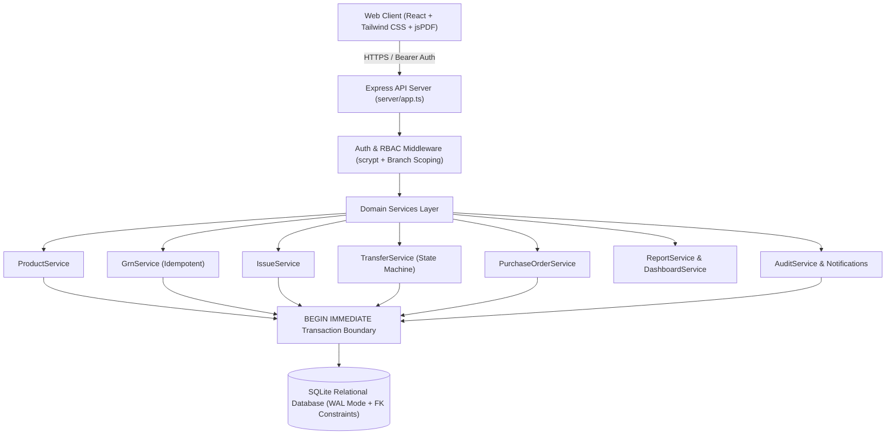
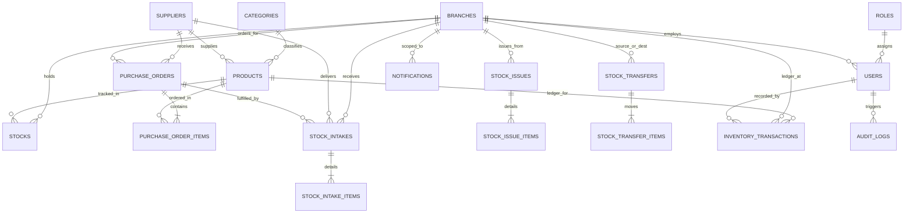
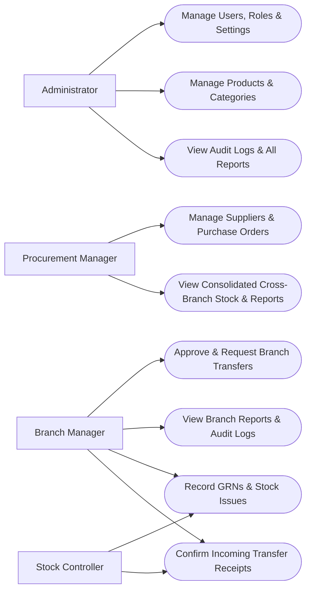

# QS-IMS System Documentation, Architecture, ERD, Manuals & UAT

## 1. System Architecture Diagram

---

## 2. Database Entity-Relationship Diagram (ERD)

---

## 3. Use Case Diagram

---

## 4. Key Inventory Workflows

### A. Purchase Order → GRN Stock Intake
1. Procurement Manager creates a Purchase Order (`draft`), reviews totals, and marks it `sent` (stock remains unchanged).
2. Goods arrive physically at the destination branch (e.g., Najjera).
3. Stock Controller or Branch Manager opens **Stock Intake / GRN**, links the PO, verifies quantities received, and posts the GRN.
4. Inside a single `BEGIN IMMEDIATE` transaction, the system increments `stocks.quantity_on_hand`, inserts immutable `inventory_transactions` (`grn`), updates `purchase_order_items.quantity_received`, and transitions PO status to `partially_received` or `received`.

### B. Inter-Branch Stock Transfer
1. Branch Manager (or Admin) creates a transfer specifying distinct `source_branch_id` and `destination_branch_id`, then submits it (`pending_approval`).
2. Source Branch Manager (or Admin) reviews source availability and marks `approved`.
3. Source Branch dispatches the transfer (`in_transit`), atomically deducting source branch `stocks` and creating a `transfer` Stock Issue + `transfer_out` ledger record.
4. Destination Branch Stock Controller or Manager confirms actual quantities received (`received`), entering discrepancy notes if any short-delivery occurred, atomically crediting destination `stocks` and recording a `transfer_in` ledger entry.

---

## 5. Administrator & User Manuals

### Administrator Manual
- **User & Role Provisioning**: Navigate to *User Management* → *Add Staff User*. Assign Branch Managers and Stock Controllers to their exact Kampala branch; Head Office roles (`admin`, `procurement_manager`) may operate across all branches. The system prevents deactivating or demoting the last active Administrator.
- **Catalogue Governance**: Create categories first, then add products with unique SKUs, UGX cost/selling prices, and reorder thresholds. New products automatically initialize `0` stock across Ntinda, Najjera, and Kyaliwajjala. Products with historical ledger entries cannot be deleted; deactivate them instead.
- **System Configuration & Audits**: Use *Settings* to update branch contacts/managers and reorder alert multipliers. Review *Audit Logs* regularly for denied branch-access attempts or manual stock adjustments.

### Branch Staff User Manual (Branch Managers & Stock Controllers)
- **Daily Stock Intake**: Use *Stock Intake / GRN* when supplier deliveries arrive. Link open POs whenever applicable so received quantities reconcile automatically.
- **Recording Issues**: Use *Stock Issues* to record sales batches, damaged items, expired removals, or authorized adjustments (reason mandatory for non-sale issues).
- **Transfer Receiving**: Check the Dashboard or *Stock Transfers* for `In Transit` shipments addressed to your branch, count physical units, and click *Confirm Receipt at Destination*.

---

## 6. User Acceptance Testing (UAT) Checklist

| Test ID | Test Name | User Role | Preconditions | Test Steps | Expected Result | Actual Result | Status |
| :--- | :--- | :--- | :--- | :--- | :--- | :--- | :--- |
| **UAT-01** | Create New Product & Initialize Branch Stock | Administrator | Logged in as `admin` | Open Products → Add Product with unique SKU `QS-TEST-901`, cost UGX 4,000, reorder 10 | Product saved; detail modal shows 0 units across Ntinda, Najjera, Kyaliwajjala | Verified via API & automated test | **PASS** |
| **UAT-02** | Create User & Assign to Najjera | Administrator | Logged in as `admin` | Open User Management → Add Staff User → Role: Stock Controller, Branch: Najjera | User created and scoped strictly to Najjera | Verified via API & RBAC guard | **PASS** |
| **UAT-03** | Record GRN Delivery of 50 Units | Stock Controller | Logged in at assigned branch | Open Stock Intake / GRN → New GRN → Add product (qty 50) → Confirm | GRN saved; branch stock increases by +50; `grn` entry added to ledger | Verified atomically | **PASS** |
| **UAT-04** | Record Stock Issue of 5 Units | Stock Controller | Branch stock >= 5 units | Open Stock Issues → Record Stock Issue → Type: Sale, Qty: 5 → Confirm | Issue saved; branch stock decreases by -5; `sale` entry added to ledger | Verified atomically | **PASS** |
| **UAT-05** | Verify Branch Stock Quantity Accuracy | Stock Controller | UAT-03 and UAT-04 completed | Open Inventory & Ledger → Check product quantity and ledger `balance_after` | `stocks.quantity_on_hand` equals opening + 50 - 5 and matches latest `balance_after` | Verified in integrity suite | **PASS** |
| **UAT-06** | Automated Low-Stock Alert Trigger | Branch Manager | Product stock <= reorder level | Issue stock until qty <= reorder level; inspect Dashboard Alerts | Product appears in Dashboard Low-Stock Alerts with accurate Shortfall & Suggested Reorder | Verified live calculation | **PASS** |
| **UAT-07** | Create Purchase Order (No Premature Stock Change) | Procurement Manager | Logged in as `procurement` | Open Purchase Orders → Create PO for Najjera → Mark as Sent | PO status is `sent`; Najjera branch stock remains unchanged | Verified via integration test | **PASS** |
| **UAT-08** | Receive Goods Against Purchase Order | Stock Controller | Open `sent` PO for branch | Open Stock Intake / GRN → Select PO → Receive partial/full qty → Post | GRN posted, stock increased, PO updates to `partially_received` or `received` | Verified via integration test | **PASS** |
| **UAT-09** | Transfer Stock Ntinda → Najjera (Dispatch) | Branch Manager / Admin | Sufficient stock at Ntinda | Create Transfer Ntinda → Najjera → Approve → Dispatch | Status becomes `in_transit`; Ntinda stock reduced & `transfer_out` ledger created | Verified via integration test | **PASS** |
| **UAT-10** | Confirm Transfer Receipt at Najjera | Branch Manager (Najjera) | Transfer is `in_transit` to Najjera | Open Transfer → Confirm Receipt at Destination | Status becomes `received`; Najjera stock credited & `transfer_in` ledger created; double-receipt blocked | Verified via integration test | **PASS** |
| **UAT-11** | Consolidated Stock Value Report & Export | Administrator | Seeded & transactional data present | Open Reports → Select *Stock Value by Branch* → Export CSV / PDF | Displays accurate branch counts, quantities, and UGX valuation; CSV/PDF downloads | Verified via API & client | **PASS** |
| **UAT-12** | Cross-Branch Access Isolation | Branch Manager (Najjera) | Logged in as `mgr.najjera` | Attempt API or forged request for Ntinda (`branch_id=1`) | Request rejected with `403 Forbidden` and logged in `audit_logs` | Verified via security test | **PASS** |
